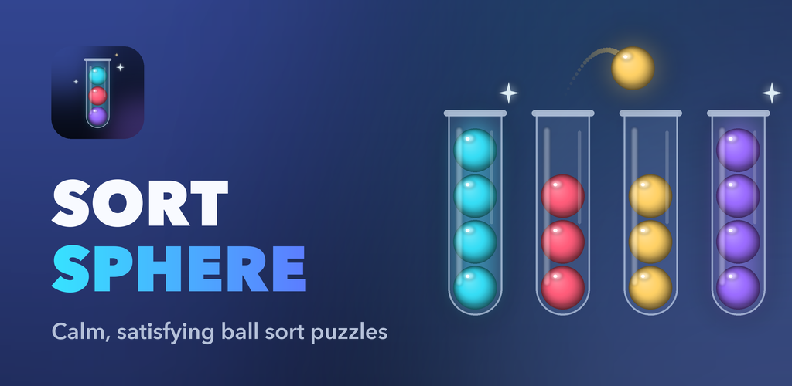
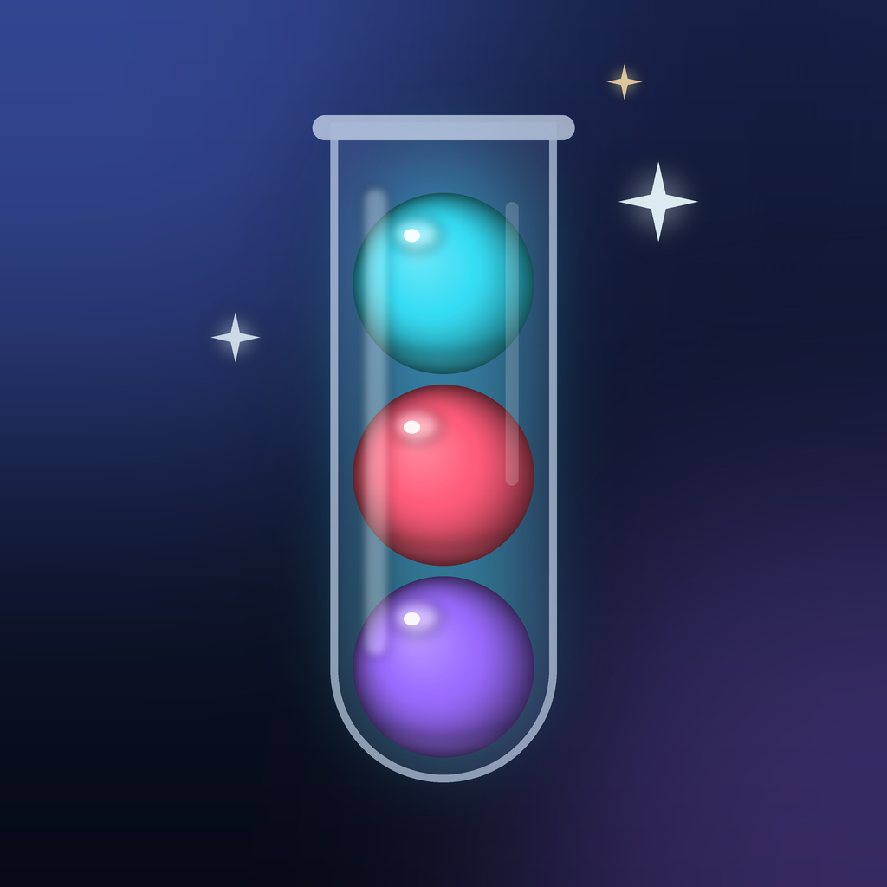
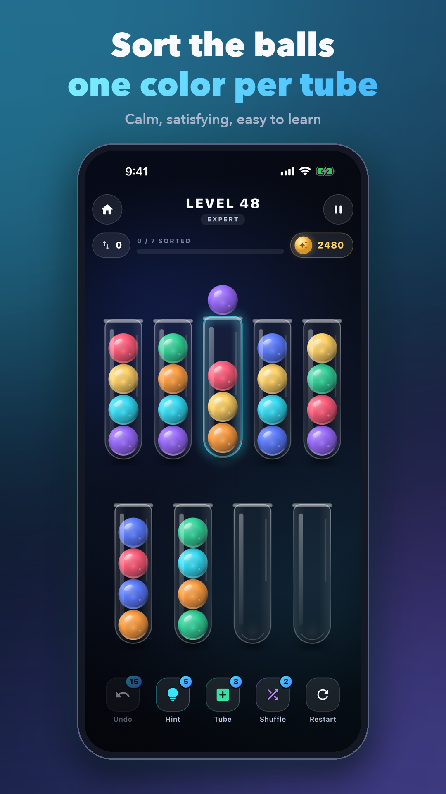
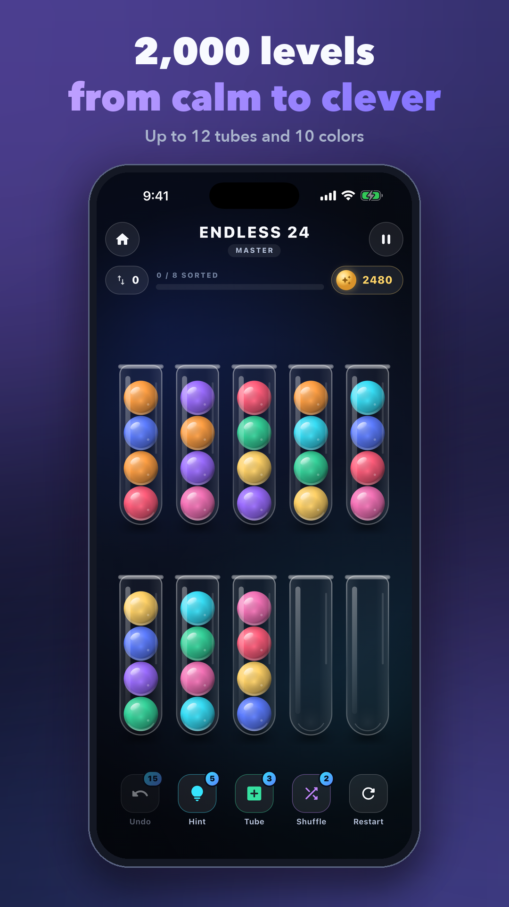
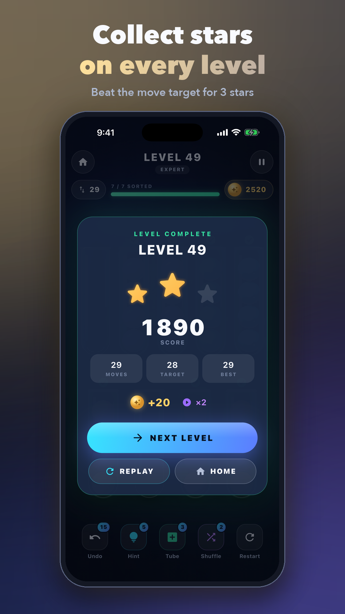
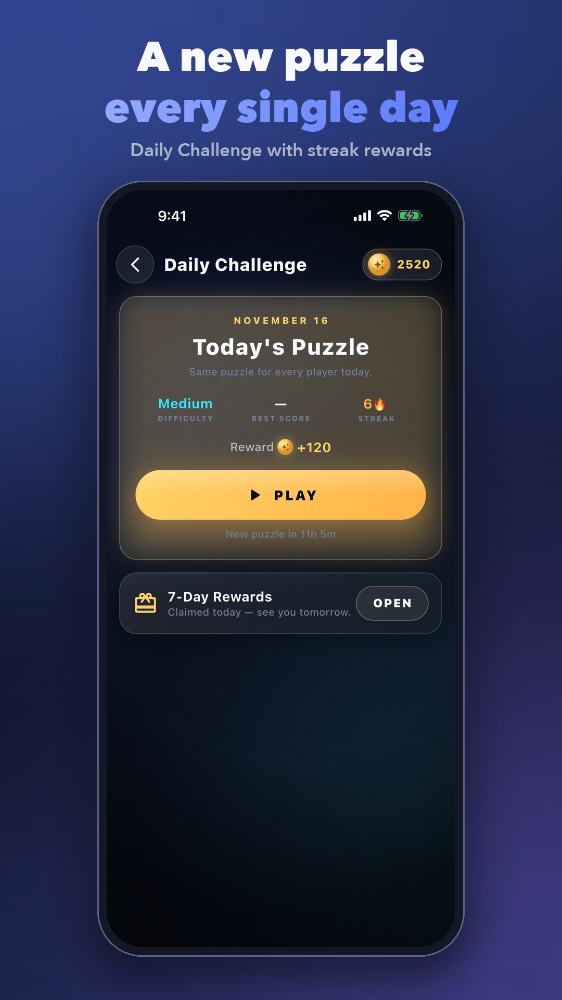
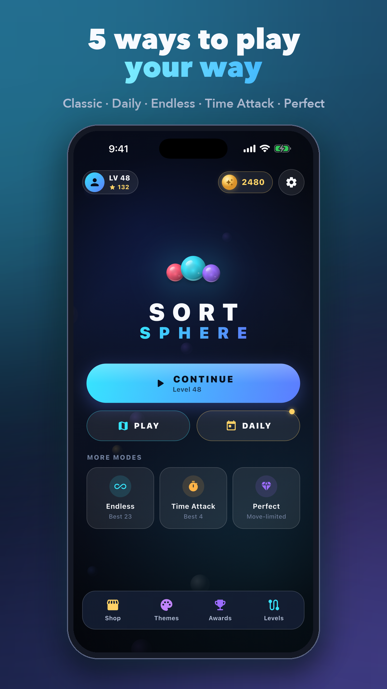
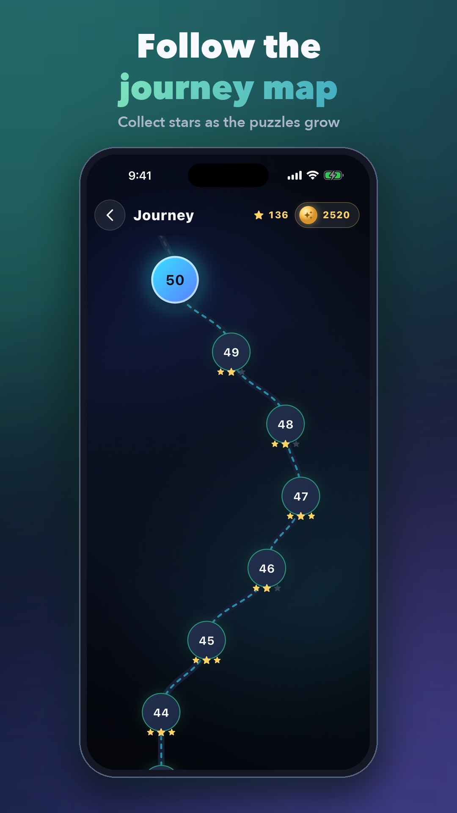
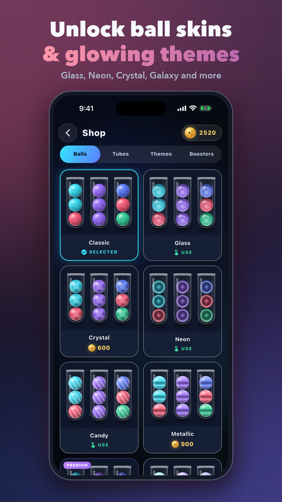
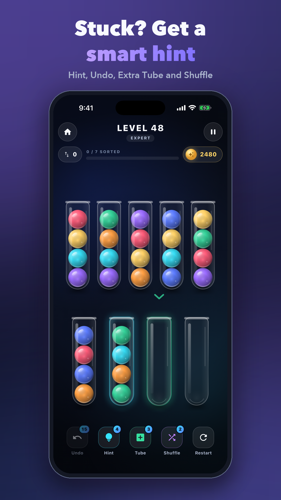

<p align="center">
  
</p>

<h1 align="center">
  
  Sort Sphere: Ball Sort Puzzle
</h1>

<p align="center">
  <b>Calm minds sort beautifully.</b><br>
  An original, premium color ball-sort puzzle for Android and iOS phones, built with Flutter.
</p>

<p align="center">
  Flutter 3.47 · Dart 3.13 · Android + iPhone · Portrait · Works offline
</p>

---

## About the game

Tap a tube to pick up its top ball, then tap another tube to drop it there, onto the same color or into an empty tube. Sort every tube into a single color to win.

- **2,000 levels**, from relaxing to clever, with up to 12 tubes and 10 colors. Every level is checked by a built-in solver, and hints come from that same solver.
- **5 modes:** Classic (journey map), Daily Challenge, Endless, Time Attack and Perfect Sort.
- **Feel:** glass tubes, glossy 3D balls, springy ball flights, sparkles on completed tubes, haptics and soft synthesized sound.
- **Offline:** everything works without internet. Only ads need a connection.

The name, logo, art, sounds and levels are all original. To rename the game, edit `lib/core/constants/app_info.dart`.

## Screenshots

| Gameplay | 2,000 levels | Level complete | Daily Challenge |
|:---:|:---:|:---:|:---:|
|  |  |  |  |
| **Five modes** | **Journey map** | **Skins & themes** | **Smart hint** |
|  |  |  |  |

## Store assets

| Asset | Size | Path |
|---|---|---|
| App icon (App Store) | 1024×1024 | `store/branding/app_icon_1024.png` |
| Play Store icon | 512×512 | `store/branding/play_store_icon_512.png` |
| Feature graphic | 1024×500 | `store/google_play/feature_graphic_1024x500.png` |
| Play screenshots | 1080×1920 ×8 | `store/google_play/screenshots/` |
| App Store 6.9" screenshots | 1320×2868 ×8 | `store/app_store/screenshots_6.9/` |
| App Store 6.5" screenshots | 1284×2778 ×8 | `store/app_store/screenshots_6.5/` |
| App Store 6.3" screenshots | 1179×2556 ×8 | `store/app_store/screenshots_6.3/` |
| App Store iPad 13" screenshots | 2048×2732 ×8 | `store/app_store/screenshots_ipad_13/` (only needed if you enable iPad) |
| Listing text, category, age rating, privacy answers | | [`store/STORE_LISTING.md`](store/STORE_LISTING.md) |

**Category:** Google Play › Game › Puzzle. App Store › Games › Puzzle, with Games › Casual as secondary. Expected rating: Everyone / 4+.

**Short description (Play, 80 chars):** Sort colorful balls into tubes. 2,000 calm, satisfying puzzles that play offline.

## Run

```bash
flutter pub get
flutter run
```

```bash
flutter test      # 69 tests: engine, solver, generator, levels, scoring, persistence, ads, game launcher, screen sizes
flutter analyze   # clean
```

## Phone sizes

The board layout (`lib/game/board/board_layout.dart`) sizes tubes and balls from the available space, and the UI scales labels down rather than overflowing. `test/responsive_test.dart` opens every screen and dialog at 360×640, 375×667 (iPhone SE), 393×851, 412×915, 440×956 and an 800×1280 tablet, at normal and 1.3× text, and fails on any overflow or layout error.

## Release (you build the bundle yourself)

- **Android package:** `com.sortsphere.sort_sphere`. **iOS bundle ID:** `com.sortsphere.sortSphere` (iPhone-only, portrait). Both are permanent after the first upload, so change them first if you want your own domain.
- **Android signing:** copy `android/key.properties.example` to `android/key.properties` and fill it in. Without that file, release builds fall back to debug signing, which Play rejects. Then:
  ```bash
  flutter build appbundle --release
  ```
- **iOS:** set your Team in Xcode (`ios/Runner.xcworkspace`), then:
  ```bash
  flutter build ipa --release
  ```
- **AdMob:** the app ships with Google's test IDs. Replace the App IDs in `AndroidManifest.xml` and `Info.plist`, put your unit IDs in `lib/services/ads/ad_config.dart` and set `_productionNotConfigured = false`.
- **Version:** bump `version:` in `pubspec.yaml` (for example `1.0.1+2`) for every upload.

## Regenerating art and screenshots

The icon, launch screens, feature graphic and framed screenshots are drawn by Pillow scripts in `tool/store_assets/` (`pip3 install pillow`):

```bash
python3 tool/store_assets/make_icon.py             # app icons (iOS + Android adaptive), splash logos
python3 tool/store_assets/make_feature_graphic.py  # 1024×500 Play feature graphic
python3 tool/store_assets/make_screenshots.py      # frames store/raw_screenshots/*.png for both stores
```

To capture new raw screenshots with demo progress (level 48, coins, stars) and no ads:

```bash
flutter run --dart-define=SCREENSHOT_MODE=true
```

In this mode, long-pressing the level title auto-plays the solver's solution, which helps capture the level-complete screen. Screenshot mode keeps its demo progress in memory only, and normal builds never include it.

Sounds and music are synthesized by `tool/generate_audio.py`, so there is no third-party audio:

```bash
python3 tool/generate_audio.py      # sounds + ambient loop
dart run tool/freeze_levels.dart    # re-curate campaign levels 1–50
dart run tool/solver_bench.dart     # generator/solver timing per tier
```

## Architecture

The board is a hybrid: Flutter widgets for all the UI, and the puzzle board drawn as one `CustomPainter` driven by a single `Ticker`. The ticker only runs while something is moving. Balls and tubes are rendered once into GPU images (`toImageSync`), so each frame just draws textured quads, with no per-frame gradients or blurs. State management uses `provider` and `ChangeNotifier`. The game rules are pure Dart with no Flutter imports.

```
lib/
  core/        constants (app_info, economy), theme (colors, typography, game themes), utils, screenshot mode
  models/      LevelData, Difficulty, GameMode, Booster, cosmetics, Achievement, DailyReward, DailyChallenge, PlayerProgress, AppSettings
  game/
    engine/    BallSortEngine (selectTube, canMove, moveBall, undo, restart, isSolved, isStuck, addTube), TubeState, GameState, Move, Scoring
    solver/    BallSortSolver (getAvailableMoves, simulateMove, isSolved, isDeadlocked, findSolution, getHint), TubeCodec, isolate helpers
    generator/ BallSortLevelGenerator, DifficultyAnalyzer
    levels/    LevelCatalog (campaign / daily / endless / special), handcrafted_levels.dart (frozen 1–50)
    board/     BoardLayout (responsive), BoardPainter, BoardWidget, BoardFx interface
    animation/ BoardAnimator (springs, ball flights, shake, glow, celebration)
    ball/ tube/ effects/   renderers, sprite cache, particle pool, confetti
  features/    home, gameplay (controller, launcher, screen, HUD, boosters, dialogs, result), levels (map), daily, shop, achievements, settings
  state/       ProgressController (economy, progress, achievements, daily systems), SettingsController
  repositories/ ProgressRepository interface + LocalProgressRepository
  services/    audio, haptics, storage, ads (AdMob), analytics, notifications, app_services (composition root)
  widgets/     glass panel, buttons, pressable, coin pill, background, logo, toasts, dialogs
tool/          store_assets/ (Pillow art scripts), generate_audio.py, freeze_levels.dart, solver_bench.dart
store/         icons, feature graphic, screenshots, STORE_LISTING.md
```

## Puzzle tech

- **Rules:** one ball moves per move, and only onto an empty tube or a matching color with space. Classic mode has no timer and no penalties.
- **Solver:** weighted A* over canonical states, where tubes are sorted so that permutations count as one state. Tubes are packed into base-11 integers with precomputed lookup tables, so expanding a state allocates nothing. Only symmetric no-op moves are pruned, so when a search runs to completion without a solution, the position really is unsolvable. A test cross-checks the solver against an independent brute-force BFS on 300 random boards.
- **Generator:** deterministic (same seed, same puzzle on every device). It deals balls randomly, rejects layouts that are too easy, and solves each candidate. Among the solvable candidates it keeps the one whose measured difficulty best fits the tier.
- **Campaign:** levels 1–3 are hand-designed, 4–50 are curated generator output frozen into source, and 51+ are generated on demand from the level number in a background isolate.
- **Hint** runs the real solver in an isolate and highlights the first move of a solution. If the position is provably dead, the game shows a friendly "Looks tricky!" dialog instead.
- **Shuffle** only accepts layouts that the solver proves solvable.

| Tier | Colors | Tubes | Empty |
|---|---|---|---|
| Tutorial | 3 | 5 | 2 |
| Easy | 4 | 6 | 2 |
| Medium | 5 | 7 | 2 |
| Hard | 6 | 8 | 2 |
| Expert | 7 | 9 | 2 |
| Master | 8–9 | 10–11 | 2 |
| Insane | 10 | 12 | 2 |

## Monetization (AdMob)

- Banners appear only on Home, Level Map, Shop and Daily, never over a puzzle.
- Interstitials show only after leaving a result card, with at least 4 levels and 90 s between them. None appear in the first 2 minutes after launch or during the tutorial.
- Rewarded ads cover hint, undo, extra tube, shuffle, coins, ×2 level coins and continue. A reward is granted **only** when `onUserEarnedReward` fires.
- Failures resolve to "no ad" and never block play. A `removeAds` flag is ready for a future Remove Ads purchase. Billing is not implemented.
- Consent goes through the UMP SDK, and Settings › Privacy can reopen the consent options.

## Accessibility

Large touch targets (48 px or more), semantic labels on every tube, Reduce Motion, Color Symbols (a shape on each ball so color isn't the only cue), text scaling up to 1.3×, and a Low graphics option.

## Notes

- Daily reminders: the toggle is stored, and `NotificationService` is where a local-notifications plugin would plug in. No plugin is bundled.
- Fonts are the platform fonts, so no font files ship with the app.
